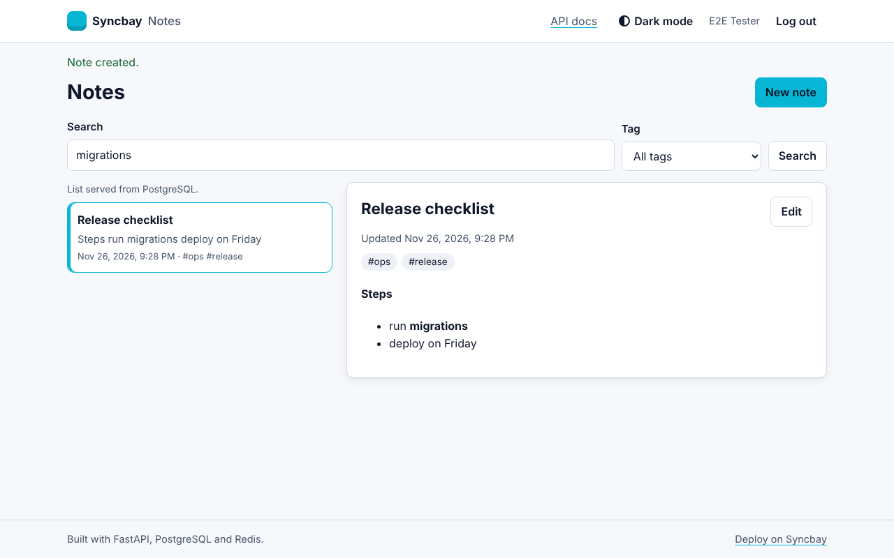
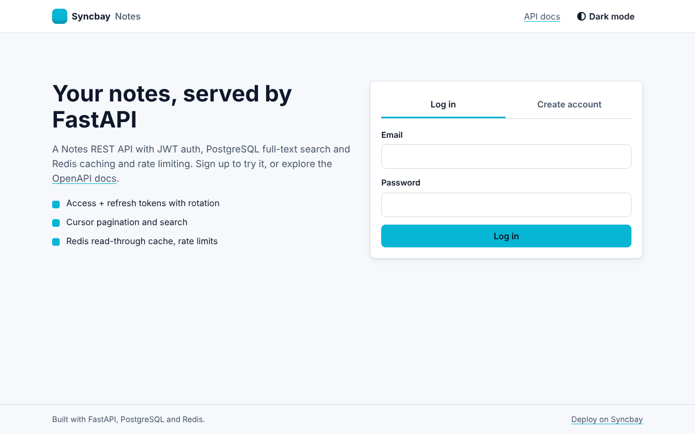
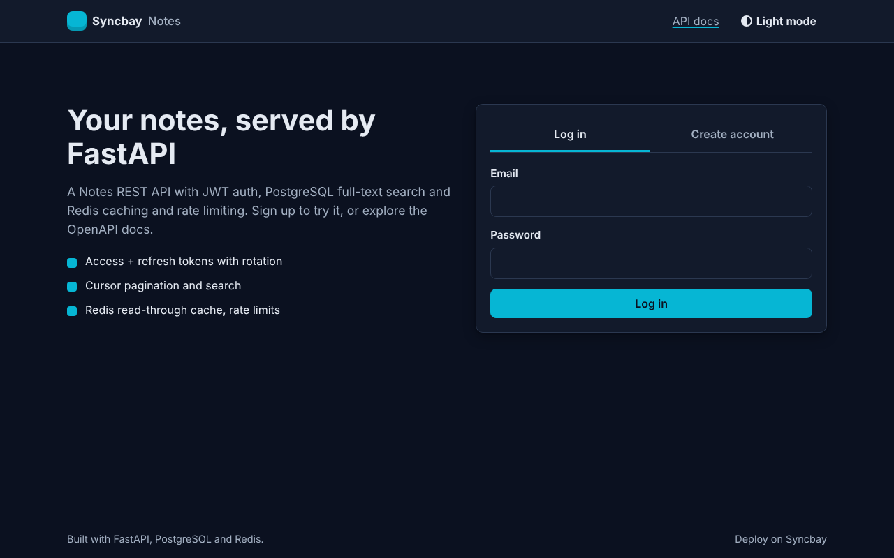
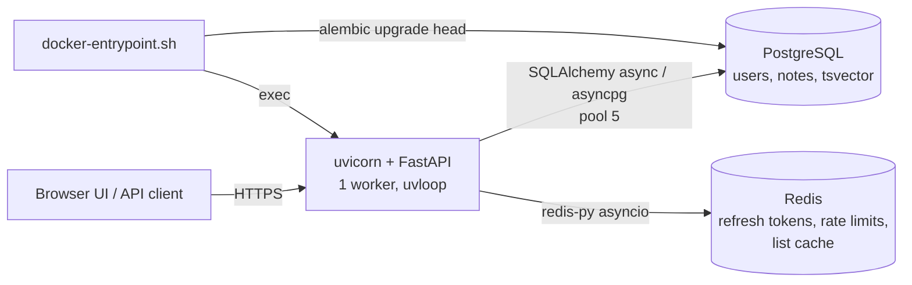

# FastAPI & Redis

A Notes REST API with JWT auth, PostgreSQL full-text search, Redis caching and rate limiting, and a small web UI. Production-shaped and ready to deploy.



[](https://syncbay.app/new?template=MSNS-DEV/syncbay-template-fastapi-redis)

## Features

- **Accounts:** register, log in, refresh and log out. Passwords are hashed with argon2id. Access tokens are short-lived JWTs (15 min). Refresh tokens rotate on every use and are tracked in Redis: if an already-used token is presented again, its whole token family is revoked. Logout revokes the family.
- **Notes:** each note has a title, a Markdown body, tags and a pinned flag. Notes are private to their owner: another user's note returns 404.
- **Search and paging:** Postgres full-text search (`tsvector` + GIN) is combined with substring matching. You can filter by tag or pinned state. Pages use keyset (cursor) pagination.
- **Redis cache:** note lists are cached with a read-through cache. Every write bumps a per-user version, which invalidates that user's cached pages at once. The `X-Cache: HIT|MISS` header shows which case applied.
- **Rate limits:** Redis fixed-window counters allow auth endpoints 10 requests per minute per IP and writes 60 per minute per user. Over the limit, the API returns `429` with `Retry-After`.
- **Web UI** at `/`: plain HTML, CSS and JavaScript with no build step. It is accessible, works from 360 px wide, and has a dark mode that follows the system setting plus a toggle. Branding comes from `BRAND_*` env vars.
- **OpenAPI docs** at `/docs`, plus `/health`, JSON logs, security headers (CSP, `frame-ancestors 'none'`) and graceful shutdown.
- **Small image:** Python 3.12 on Alpine, multi-stage, runs as non-root. The image is about 133 MB and the app idles at about 67 MB of RAM (see [`docs/metrics.json`](docs/metrics.json)).

| Light | Dark |
| --- | --- |
|  |  |

## Quick start

```bash
docker compose up
```

Open <http://localhost:15100>, create an account (it starts with three welcome notes) and try the API at <http://localhost:15100/docs>. Migrations run automatically when the app starts. Set `APP_PORT` to change the host port.

## Local development without Docker

You need Python 3.12, [uv](https://docs.astral.sh/uv/), PostgreSQL 16 and Redis 7.

```bash
uv sync                                   # creates .venv with app + dev dependencies
cp .env.example .env                      # then edit DATABASE_URL / REDIS_URL
set -a && . ./.env && set +a
uv run alembic upgrade head               # create the schema
uv run uvicorn app.main:app --reload --port 8000
```

Set `COOKIE_SECURE=false` if you serve the UI over plain HTTP on a host other than `localhost`.

## Environment variables

| Variable | Default | Description |
| --- | --- | --- |
| `DATABASE_URL` | required | `postgresql://…`. It is converted to `postgresql+asyncpg://`, and `sslmode` is supported. |
| `REDIS_URL` | required | `redis://…` or `rediss://…` |
| `JWT_SECRET` | required | HS256 signing key, at least 32 characters |
| `PORT` | `8000` | Listen port |
| `ACCESS_TOKEN_TTL_SECONDS` | `900` | Access token lifetime |
| `REFRESH_TOKEN_TTL_SECONDS` | `1209600` | Refresh token lifetime (14 days) |
| `RATE_LIMIT_AUTH_PER_MINUTE` | `10` | Register, login and refresh requests per IP per minute |
| `RATE_LIMIT_WRITE_PER_MINUTE` | `60` | Note writes per user per minute |
| `CACHE_TTL_SECONDS` | `60` | Lifetime of a cached list page |
| `TRUSTED_PROXY_HOPS` | `0` | Number of proxies that append to `X-Forwarded-For` (use `1` on Syncbay) |
| `COOKIE_SECURE` | `true` | Sets the `Secure` flag on auth cookies |
| `DB_POOL_SIZE` | `5` | SQLAlchemy pool size |
| `LOG_LEVEL` | `info` | One of `debug`, `info`, `warning`, `error` |
| `SEED_DEMO_DATA` | `true` | Gives each new account three welcome notes |
| `BRAND_NAME` | `Syncbay` | Name shown in the header |
| `BRAND_LOGO_URL` | – | Optional logo URL |
| `BRAND_PRIMARY` | `#06b6d4` | Primary colour (hex) |

The app exits at startup with a clear message if a required variable is missing or invalid. See [`.env.example`](.env.example).

## Architecture



- `app/main.py` contains the app factory and the lifespan, which opens the pools at startup and closes them on shutdown.
- `app/routers/` holds the route handlers: `auth.py`, `notes.py` and `meta.py` (health, config, UI).
- `app/security.py` handles argon2id hashing and JWTs. `app/ratelimit.py` is the fixed-window limiter. `app/cache.py` is the versioned list cache.
- `migrations/` holds the Alembic migrations, which are serialised with a Postgres advisory lock.
- `app/static/` contains the web UI, including a small Markdown renderer that escapes HTML first.

The full spec is in [`docs/spec.md`](docs/spec.md).

## Tests

```bash
uv run ruff check . && uv run ruff format --check .   # lint + format
uv run mypy                                            # strict type check
uv run pytest tests/unit                               # unit tests, no services needed

# API tests run the app in-process against the compose Postgres and Redis:
docker compose -f compose.yaml -f compose.test.yaml up -d --wait
uv run pytest tests/api

# Playwright end-to-end tests against the running stack on :15100
cd e2e && npm ci && npx playwright install chromium && npm test
```

The end-to-end suite covers health, register → create → search → edit → delete, validation errors, dark mode and the `429` after the auth rate limit is exceeded. It also refreshes the screenshots in `docs/screenshots/`. CI (`.github/workflows/ci.yml`) runs all of these, plus `docker build` and `pip-audit`.

## Deploy on Syncbay

Click **Deploy to Syncbay** above. `syncbay.json` asks Syncbay for a PostgreSQL database (`DATABASE_URL`) and a Redis instance (`REDIS_URL`), and generates `JWT_SECRET`. It sets `TRUSTED_PROXY_HOPS=1`, so rate limits apply to the real client IP behind the Syncbay edge. The health check path is `/health` and the app listens on port 8000.

## License

[MIT](LICENSE)

---

Built by [MSNS-DEV](https://github.com/MSNS-DEV) · Deploy on [Syncbay](https://syncbay.app)
